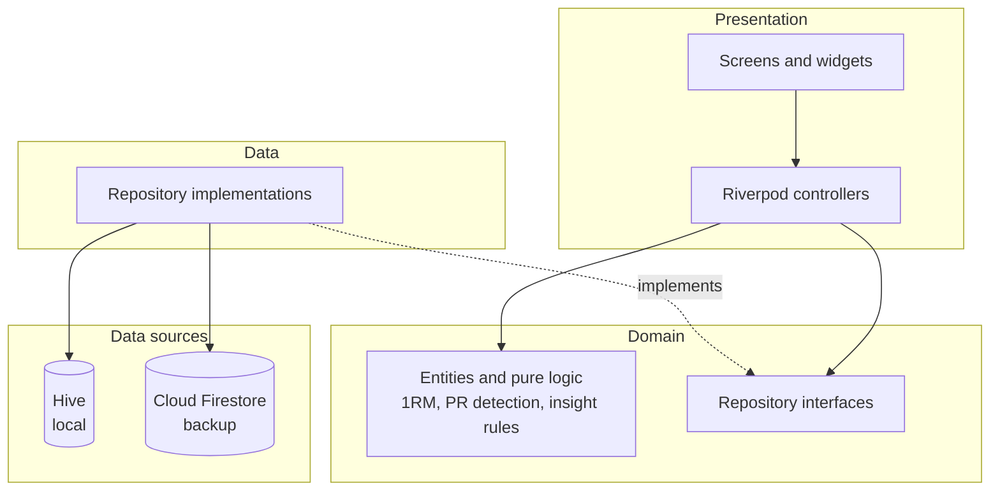

# Strivo

Strivo is a workout tracker I built for strength training. It is offline-first,
so logging a set never waits on the network, and every account backs up to the
cloud. The whole app is built around the two things a lifting app has to get
right: logging fast while you train, and showing you afterwards whether you are
actually progressing.

[](https://github.com/Abhishek-S-777/strivo/actions/workflows/ci.yaml)


> Screenshots: add captures of Home, Active Workout, and Analytics here.

## What it does

Logging is the part that has to be fast, so each set starts pre-filled from the
last time you did that exercise. Weight and reps step with a tap, the rest timer
starts the moment you check a set off, and the session auto-saves, so nothing is
lost if the app is killed mid-workout.

Routines are reusable templates. Programs go a step further: multi-week plans
with per-week set and rep targets and a pointer that advances to the next day as
you complete sessions.

The analytics are what you look at between workouts: an estimated 1RM trend per
lift (Epley), weekly volume you can page back through, a muscle-group split, and
a 12-week consistency heatmap. On top of that, a small rule engine reads your
history and surfaces what's worth knowing: new PRs, plateaus, volume milestones,
streaks, muscle imbalances, and signs you should back off.

Weights are stored in kilograms and converted on the fly, so switching between
kg and lbs never rewrites or corrupts your data.

## Architecture

The code is feature-first, and each feature is split into three layers:

- `domain` holds entities and pure logic (1RM, PR detection, the insight rules).
  It has no Flutter, Hive, or Firebase in it, which keeps it cheap to unit-test.
- `data` holds the repository implementations that sit over the Hive and
  Firestore data sources.
- `presentation` holds the screens, widgets, and Riverpod controllers.

Controllers only ever talk to repository interfaces, never to Hive or Firebase
directly, so the storage underneath stays swappable and easy to fake in tests.



State is plain Riverpod 2 (`StateNotifier`/`Notifier`, no code generation).
[DATA_MODEL.md](DATA_MODEL.md) has the schema, and [docs/decisions/](docs/decisions/)
records the reasoning behind the sync model and the security rules.

## Tech stack

Flutter, Dart, Riverpod, go_router, Hive, Firebase Auth, Cloud Firestore, and
fl_chart. Linting is `very_good_analysis` with strict casts, and CI runs format,
analyze, and tests on every push and pull request.

## Project structure

```text
lib/
  core/        router, theme, units, logging, settings, services, utils
  features/<feature>/
    domain/        entities and pure logic (+ repository interfaces)
    data/          repository implementations over Hive + Firestore
    presentation/  screens, widgets, Riverpod controllers
  shared/        widgets reused across features
test/            unit and widget tests mirroring lib/
```

## Running it locally

You need the Flutter SDK (3.38.x). I develop this with [FVM](https://fvm.app/),
but a plain `flutter`/`dart` on your `PATH` works fine too.

```bash
flutter pub get
flutter run
```

### Pointing it at your own Firebase

The `firebase_options.dart` and `google-services.json` in the repo point at the
original project. To use your own:

1. Create a Firebase project, then turn on Email/Password auth and Cloud
   Firestore.
2. Install the FlutterFire CLI and run `flutterfire configure`. It rewrites
   `lib/firebase_options.dart` and the Android config for you.
3. Deploy the rules in [firestore.rules](firestore.rules) so each user can only
   read and write their own data.

## Security

The Firebase config in the repo identifies the project but is not a secret. A
client app ships those files inside its binary no matter what, so the real access
control lives on the server. Every account's data sits under `users/{uid}`, and
[firestore.rules](firestore.rules) lets a signed-in user touch only their own
subtree. Beyond that, the API key should be restricted and App Check enabled in
the Google Cloud console; the reasoning is written up in
[docs/decisions/0004-firebase-config-hardening.md](docs/decisions/0004-firebase-config-hardening.md).

## Testing

```bash
flutter analyze        # zero issues under very_good_analysis
flutter test           # unit + widget tests
```

## Documentation

- [GUIDE.md](GUIDE.md) walks through each feature and the formulas it uses.
- [DATA_MODEL.md](DATA_MODEL.md) covers the local (Hive) and cloud (Firestore) schema.
- [docs/decisions/](docs/decisions/) holds the architecture decision records.

## A note on authorship

Built with AI assistance; the architecture, review, and refactoring are mine.

## License

MIT, see [LICENSE](LICENSE).
