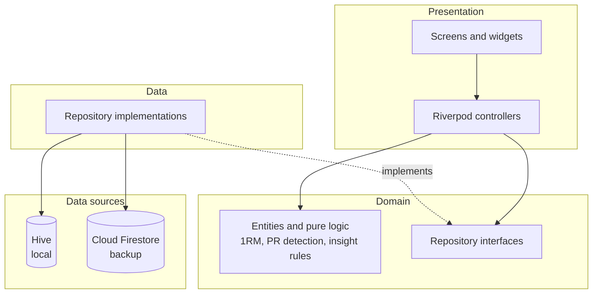

# Strivo

An offline-first gym workout tracker for strength training: fast set logging,
strength analytics, and automatic training insights, with per-account cloud
backup.

[](https://github.com/Abhishek-S-777/strivo/actions/workflows/ci.yaml)


> Screenshots: _add captures of Home, Active Workout, and Analytics here._

## Features

- **Fast logging** — each set pre-fills from the last time you did the exercise;
  weight and reps use tap-to-step inputs; a rest timer starts on set completion;
  the active session auto-saves so it survives an app kill.
- **Programs and routines** — reusable routine templates, plus multi-week
  programs with per-week set/rep targets and a position pointer that advances as
  you train.
- **Strength analytics** — estimated 1RM (Epley) trend per lift, weekly volume
  with history paging, muscle-group distribution, and a 12-week consistency
  heatmap.
- **Training insights** — a rule engine flags personal records, strength
  trends and plateaus, volume milestones, consistency streaks, muscle
  imbalances, overtraining risk, and recovery.
- **Offline-first with cloud sync** — Hive is the local source of truth;
  Cloud Firestore is a per-account backup that restores on sign-in.
- **kg or lbs** — weights are stored in kilograms and converted for display and
  input, so the unit can be switched at any time without data loss.

## Architecture

Strivo is feature-first. Each feature is split into `domain` (entities and pure
logic), `data` (repository implementations over the data sources), and
`presentation` (screens, widgets, and Riverpod controllers). Presentation
depends only on repository interfaces — no Firebase or Hive calls leak into the
UI.



- **Entities and pure logic** live in `domain` and are unit-tested in isolation
  (no Flutter, Hive, or Firebase).
- **Repositories** wrap the `HiveService` and `FirestoreSyncService` data
  sources; controllers receive them through Riverpod providers, which makes them
  trivial to replace with fakes in tests.
- **State** uses Riverpod 2 `StateNotifier`/`Notifier` controllers (no code
  generation).

See [DATA_MODEL.md](DATA_MODEL.md) for the local and cloud schema, and
[docs/decisions/](docs/decisions/) for the architecture decision records.

## Tech stack

Flutter · Dart · Riverpod · go_router · Hive · Firebase Auth · Cloud Firestore ·
fl_chart. Lints use `very_good_analysis` with strict casts; CI runs format,
analyze, and tests on every push and pull request.

## Project structure

```text
lib/
  core/        router, theme, units, logging, settings, services, utils
  features/<feature>/
    domain/        entities and pure logic (+ repository interfaces)
    data/          repository implementations over Hive + Firestore
    presentation/  screens, widgets, Riverpod controllers
  shared/        widgets reused across features
test/            unit and widget tests mirroring lib/
```

## Running locally

Requires the Flutter SDK (3.38.x). This project is developed with
[FVM](https://fvm.app/); plain `flutter`/`dart` on your `PATH` work too.

```bash
flutter pub get
flutter run
```

### Using your own Firebase project

The committed `firebase_options.dart` and `google-services.json` point at the
original project. To run against your own:

1. Create a Firebase project and enable **Email/Password** auth and
   **Cloud Firestore**.
2. Install the FlutterFire CLI and run `flutterfire configure`, which rewrites
   `lib/firebase_options.dart` and the Android config.
3. Deploy the owner-only rules in [firestore.rules](firestore.rules) so each
   user can read and write only their own document subtree.

## Security

The committed Firebase config (`firebase_options.dart`, `google-services.json`)
identifies the project but is not a secret — a client app ships these in its
binary, so access control is enforced on the server. All user data lives under
`users/{uid}`, and [firestore.rules](firestore.rules) grants read/write only to
the authenticated owner. The project's API key should additionally be restricted
and App Check enabled in the Google Cloud console. See
[docs/decisions/0004-firebase-config-hardening.md](docs/decisions/0004-firebase-config-hardening.md).

## Testing

```bash
flutter analyze        # zero issues under very_good_analysis
flutter test           # unit + widget tests
```

## Documentation

- [GUIDE.md](GUIDE.md) — feature-by-feature walkthrough and the formulas used.
- [DATA_MODEL.md](DATA_MODEL.md) — local (Hive) and cloud (Firestore) schema.
- [docs/decisions/](docs/decisions/) — architecture decision records.

## Note on authorship

Built with AI assistance; architecture, review and refactoring by me.

## License

Released under the [MIT License](LICENSE).
