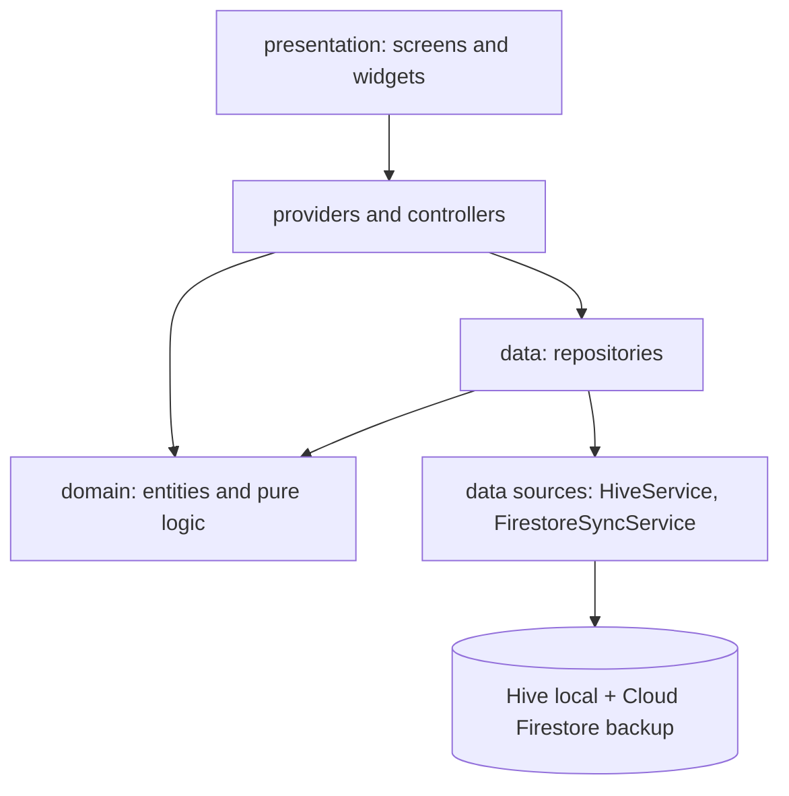
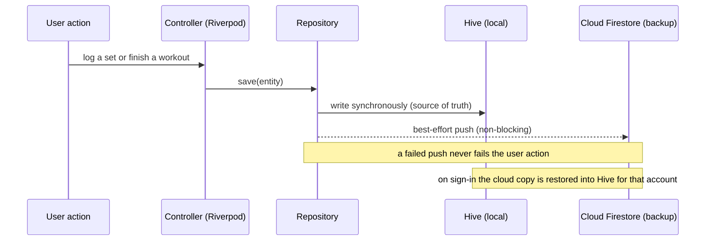

# Strivo

A gym workout tracker for strength training. It is offline-first, so logging a
set never waits on the network, and every account backs up to the cloud. The app
is built around the two things a lifting app has to get right: logging fast while
you train, and showing you afterwards whether you are actually progressing.

[](https://github.com/Abhishek-S-777/strivo/actions/workflows/ci.yaml)


## Contents

- [Features](#features)
- [Architecture](#architecture)
- [The sync model end to end](#the-sync-model-end-to-end)
- [Tech stack](#tech-stack)
- [Data model and security](#data-model-and-security)
- [Getting started](#getting-started)
- [Running the tests](#running-the-tests)
- [Privacy](#privacy)
- [How it was built](#how-it-was-built)
- [License](#license)

## Features

- Fast logging. Each set pre-fills from the last time you did the exercise.
  Weight and reps step with a tap, the rest timer starts the moment you check a
  set off, and the session auto-saves, so nothing is lost if the app is killed
  mid-workout.
- Routines and programs. Routines are reusable templates. Programs go further:
  multi-week plans with per-week set and rep targets and a pointer that advances
  to the next day as you complete sessions.
- Strength analytics. An estimated 1RM trend per lift (Epley), weekly volume you
  can page back through, a muscle-group split, and a 12-week consistency heatmap.
- Training insights. A rule engine reads your history and flags new PRs,
  plateaus, volume milestones, consistency streaks, muscle imbalances,
  overtraining risk, and recovery.
- Offline-first with cloud sync. Hive is the local source of truth. Cloud
  Firestore is a per-account backup that restores on sign-in.
- Units. Weights are stored in kilograms and converted on the fly, so switching
  between kg and lbs never rewrites or corrupts your data.

A full feature-by-feature walkthrough, with the formulas, is in
[GUIDE.md](GUIDE.md).

## Architecture

The app follows a feature-first layout with a small, explicit layering inside
each feature.

- `presentation` holds screens, widgets, and Riverpod controllers.
- `domain` holds plain entities and pure logic (for example the Epley 1RM,
  PR detection, and the insight rules). It has no Flutter, Hive, or Firebase
  imports, which is what makes it directly unit testable.
- `data` holds the repositories that read and write through the Hive and
  Firestore data sources and map records to and from entities.

Controllers only ever talk to repository interfaces, never to Hive or Firebase
directly. That single seam is what lets the tests swap in in-memory fakes, and it
keeps the storage underneath free to change.



Directory layout:

```
lib/
  core/
    logging/   AppLogger wrapper over dart:developer
    router/    go_router configuration
    services/  Hive and Firestore data sources
    settings/  key-value settings repository
    sync/      cloud sync repository
    theme/     colors, spacing, typography
    units/     kg and lbs conversion and formatting
    utils/     shared helpers
  features/<feature>/
    data/          repository implementations over Hive + Firestore
    domain/        entities and pure logic (+ repository interfaces)
    presentation/  screens, widgets, Riverpod controllers
  shared/          widgets reused across features
```

Features: `auth`, `workout`, `routines`, `programs`, `analytics`,
`progress_photos`, `profile`. The decisions behind the structure are recorded in
[docs/decisions/](docs/decisions/).

## The sync model end to end

Offline-first is the backbone of the app, and it shows how the layers fit
together. A write has to succeed instantly in the gym whether or not there is a
connection, so Hive is the source of truth and Firestore is a backup that the
write reaches on a best-effort basis.



The in-progress workout is also auto-saved to its own Hive box, so a session
survives a crash or a force-quit and can be resumed.

## Tech stack

| Category | Technology |
|----------|------------|
| Framework | Flutter 3.38.5 (pinned with FVM) |
| Language | Dart 3.10 |
| State management | Riverpod 2 (StateNotifier and Notifier, no code generation) |
| Navigation | go_router |
| Local storage | Hive |
| Backend | Firebase Auth and Cloud Firestore |
| Charts | fl_chart |
| Lints | very_good_analysis (strict casts and raw types) |
| Tests | flutter_test and mocktail |

## Data model and security

Strivo is offline-first. The local Hive store is the working source of truth, and
Cloud Firestore is a per-account backup that syncs across devices. Both share the
same JSON shape (`toMap()`/`fromMap()` on each entity), so a record moves between
them losslessly. All cloud data sits under one document per account, so one
account's data is never mixed with anyone else's.

```
users/{uid}
  displayName, email, createdAt, updatedAt, preferences
  sessions/{id}    one completed workout (embeds exercises and sets)
  routines/{id}    a reusable routine template
  programs/{id}    a multi-week program with per-week targets
  exercises/{id}   custom exercises added by the user
```

Access control lives in the repository:

- `firestore.rules` restricts everything under `users/{uid}` to the signed-in
  owner of that subtree, and denies everything else by default.
- `firestore.indexes.json` holds the composite indexes the queries need.
- The committed Firebase config identifies the project but is not a secret; a
  client app ships it in its binary, so the rules are the real control. The API
  key should also be restricted and App Check enabled in the Google Cloud
  console.

The full local and cloud schema is in [DATA_MODEL.md](DATA_MODEL.md), and the
security reasoning is in
[docs/decisions/0003-owner-only-firestore-rules.md](docs/decisions/0003-owner-only-firestore-rules.md)
and
[docs/decisions/0004-firebase-config-hardening.md](docs/decisions/0004-firebase-config-hardening.md).

## Getting started

Prerequisites:

- Flutter 3.38.5 (FVM recommended)
- Android Studio or VS Code
- An Android device or emulator
- Your own Firebase project

```bash
git clone <repository-url>
cd strivo
fvm flutter pub get
fvm flutter run
```

Point the app at your own Firebase project:

1. Create a project at the Firebase console.
2. Register an Android app with the package name `com.strivo.strivo` and add the
   debug SHA-1 key.
3. Download `google-services.json` into `android/app/`.
4. Enable Email and Password authentication and Cloud Firestore.
5. Deploy the rules and indexes:

   ```bash
   firebase deploy --only firestore:rules,firestore:indexes
   ```

The FlutterFire CLI (`flutterfire configure`) will regenerate
`lib/firebase_options.dart` for your project.

## Running the tests

Unit and widget tests:

```bash
fvm flutter test
```

Static analysis under the strict lint set:

```bash
fvm flutter analyze
```

## Privacy

Data is scoped to a single account and stored in the Firebase project you deploy
to. There are no global feeds and no cross-account access. Weights and workout
history never leave your own account's document subtree.

## How it was built

I built Strivo with AI tools (Claude Code) for scaffolding and first-pass reviews. I designed the architecture and the sync model, and I reviewed, tested and refactored every change. After the first version, I refactored it in a series of small pull requests, one concern each (data layer, screen splits, tests, CI). The reasoning behind the main choices is in [docs/decisions](docs/decisions).

## License

Released under the MIT License. See [LICENSE](LICENSE).
